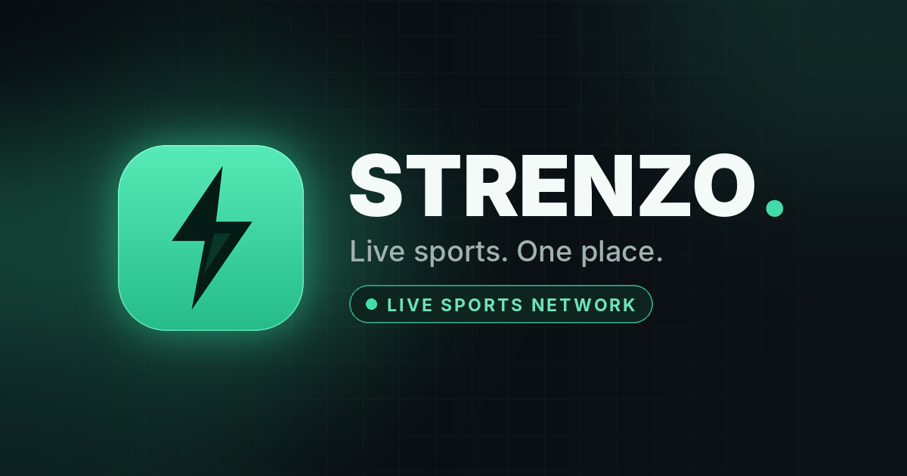

<p align="center">
  
</p>

<p align="center">
  
  
  
  
  
  
  
  
</p>

<!--
  Live badges: replace USERNAME and REPO, then remove this comment.

<p align="center">
  <a href="https://github.com/USERNAME/REPO/actions/workflows/deploy.yml"></a>
  
  
</p>
-->

<h1 align="center">STRENZO</h1>
<p align="center"><b>Live Sports Network</b> — a fast, clean, installable live sports hub.</p>

---

## Features

- **Discover, Live now and Favorites** — browse every event, jump to what is live, and save the ones you care about
- **Sport categories and search** — filter by sport or search teams and leagues
- **Smart server failover** — automatically moves between Primary, Fallback and Mirror servers
- **Status page** — live health of every server with latency, uptime and recent history
- **Installable PWA** — add to your home screen, works offline for the app shell
- **Friendly offline popup** — clear messaging when you are offline or the service is unreachable
- **No build step** — plain HTML, CSS and JavaScript

## Deploy to GitHub Pages

1. Create a new GitHub repository and push these files to the `main` branch (keep `index.html` at the repo root).
2. In the repo go to **Settings → Pages → Build and deployment → Source** and choose **GitHub Actions**.
3. Push to `main` (or run the workflow from the **Actions** tab). The site goes live at `https://<username>.github.io/<repo>/`.

All paths are relative, so it works both on a project URL (`/<repo>/`) and on a custom domain.
To use a custom domain, add it under **Settings → Pages** and add a `CNAME` file containing the domain to the repo root, then add `CNAME` to the `cp` line in `.github/workflows/deploy.yml`.

After changing any file, bump `VERSION` in `sw.js` so installed copies pick up the update.

## Other hosts

On Cloudflare Pages or Netlify, publish the repo root. The included `_headers` file sets sensible caching and security headers
(it is ignored by GitHub Pages). Inter is bundled in `fonts/` (SIL Open Font License), so no external requests are needed for fonts.

## Repo cover (shown when the repo link is shared, e.g. on Discord)

Upload `.github/social-preview.png` under **Settings → General → Social preview → Edit → Upload an image**.

## Run locally

```bash
python3 -m http.server 8000
```

Then open http://localhost:8000 (service workers need localhost or https).

---

<p align="center">Released under the <a href="LICENSE">MIT License</a> · STRENZO · Build by AziF &amp; Yoru</p>
